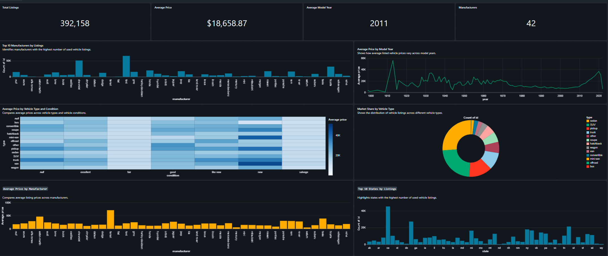

# Used Vehicle Market Analytics

An end-to-end data engineering project that processes used vehicle listing data and transforms it into structured datasets for market analysis and visualization.

## Architecture

The following diagram illustrates the data flow from source data ingestion through storage, transformation, and dashboard reporting.


## Dashboard Preview

The dashboard provides a consolidated view of the used vehicle market, covering listing volumes, average prices, model years, manufacturers, vehicle types, and geographic distribution.



## Project Overview

I built this project using a Craigslist used vehicle listings dataset containing approximately 426K records. The pipeline follows a Bronze–Silver–Gold architecture to organize raw data ingestion, data cleaning, transformation, and analytical preparation.

The resulting datasets support SQL-based analysis and a Databricks dashboard for exploring vehicle pricing, manufacturer distribution, vehicle categories, conditions, and state-wise listing volumes.

## Technology Stack

| Technology | Purpose |
|---|---|
| Azure Data Factory | Data ingestion and pipeline orchestration |
| Azure Data Lake Storage Gen2 | Data storage |
| Azure Databricks | Data processing and transformation |
| PySpark | Data cleaning and transformations |
| Databricks SQL | Analytical queries |
| Databricks Dashboards | Data visualization |

## Data Pipeline

### 1. Bronze — Raw Data Ingestion

Ingests the source vehicle listing data and retains it in the initial processing layer for downstream transformations.

### 2. Silver — Data Cleaning

Cleans and transforms the ingested data to prepare a more consistent dataset for analysis.

### 3. Gold — Analytics-Ready Data

Prepares structured datasets for analytical queries, market analysis, and dashboard reporting.

## Dashboard Features

The Used Vehicle Market Analytics dashboard includes:

- **Total Listings:** Total number of vehicle listings analyzed.
- **Average Price:** Average listed vehicle price.
- **Average Model Year:** Average model year across the dataset.
- **Manufacturers:** Number of manufacturers represented.
- **Manufacturer Analysis:** Listing distribution across manufacturers.
- **Price Trends:** Average listed price by model year.
- **State-wise Distribution:** Listing volumes across states.
- **Vehicle Type and Condition:** Average price comparisons across vehicle categories and conditions.
- **Vehicle Type Market Share:** Distribution of listings by vehicle type.

## Repository Structure

```text
car-sales-data-pipeline/
├── 00_setup.ipynb
├── 01_bronze_ingestion.ipynb
├── 02_silver_cleaning.ipynb
├── 03_gold_layer.ipynb
├── Used Vehicle Analytics Data Pipeline.png
├── dashboard.png
└── README.md
```

## Notebooks

| Notebook | Description |
|---|---|
| `00_setup.ipynb` | Initial project setup and configuration |
| `01_bronze_ingestion.ipynb` | Ingests source data into the Bronze layer |
| `02_silver_cleaning.ipynb` | Cleans and transforms the ingested data |
| `03_gold_layer.ipynb` | Prepares the Gold layer for analysis |

## Project Outcomes

- Developed a multi-stage data pipeline using Bronze, Silver, and Gold processing layers.
- Organized ingestion, cleaning, and analytical preparation into dedicated notebooks.
- Prepared structured data for SQL analysis and dashboard reporting.
- Created a dashboard to explore vehicle listings, pricing patterns, manufacturers, and geographic distribution.
- Documented the pipeline architecture and included visual previews of the implementation.

## Running the Project

The notebooks are provided in execution order. To reproduce the pipeline, configure the required Azure resources, storage access, and Databricks environment before running the notebooks.

The dashboard image is a static preview. Access to the interactive Databricks dashboard and underlying data may require appropriate workspace permissions.

---

**Project Focus:** Data Engineering · PySpark · Azure · SQL Analytics · Data Visualization